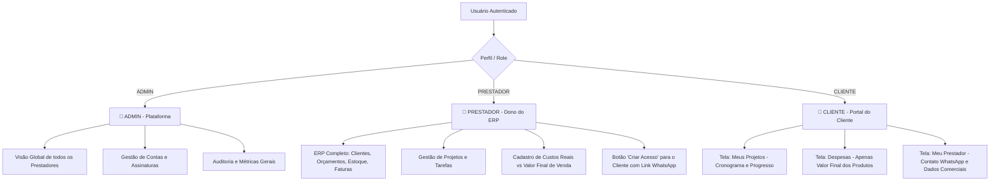
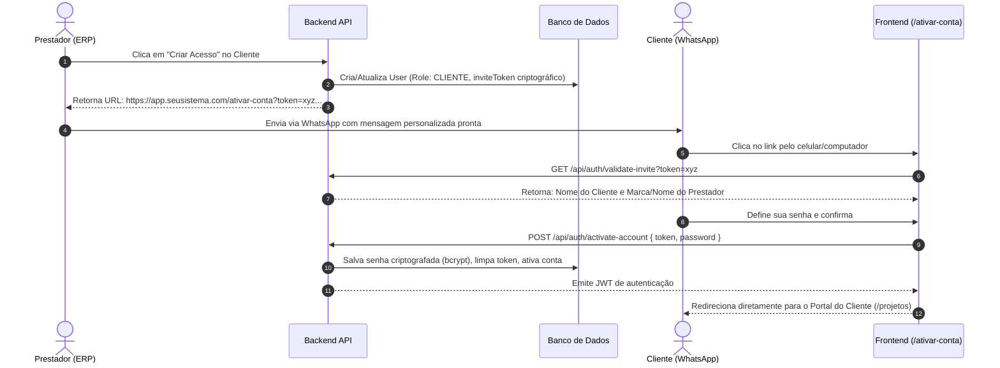

# 📋 Plano de Ação e Especificação Arquitetural: SaaS Multi-Tenant & Portal do Cliente

> **Projeto**: ERP / Gestão Empresarial com Portal do Cliente  
> **Status**: Planejamento Aprovado  
> **Arquitetura**: Multi-Tenant (Express + Prisma MySQL + Next.js App Router)  
> **Data de Criação**: 26/10/2026  

---

## 📑 Sumário Executivo

Este documento descreve detalhadamente a transformação do sistema de gestão empresarial de uma aplicação monoprestador para uma plataforma **SaaS Multi-Tenant** com controle de acesso baseado em funções (**RBAC - Role-Based Access Control**).

O sistema suportará três perfis de usuários com escopos rigorosamente delimitados:
1. **`ADMIN`**: Superusuário da plataforma para administração global.
2. **`PRESTADOR`**: Usuário operacional do ERP (cada um com seu ambiente comercial e estoque isolados).
3. **`CLIENTE`**: Usuário final com acesso restrito a um **Portal do Cliente** transparente, contendo apenas seus projetos, despesas com valores finais de repasse e canal de contato direto com o prestador contratado.

---

## 🏛️ 1. Definição dos 3 Perfis de Usuário (RBAC)



### 1.1. Perfil `ADMIN` (Superadministrador)
* **Objetivo**: Gestão técnica e operacional da plataforma como SaaS.
* **Escopo**:
  * Visualiza todos os prestadores e clientes cadastrados.
  * Habilita, desabilita ou gerencia limites de contas.
  * Monitora volumetria da plataforma (faturamento transacionado, total de projetos ativos).

### 1.2. Perfil `PRESTADOR` (Inquilino / Tenant do ERP)
* **Objetivo**: Administrar a sua própria prestação de serviços com autonomia total.
* **Escopo**:
  * Isolamento completo: não visualiza nenhum dado de outro prestador.
  * Acesso a todos os módulos do ERP: Dashboard, Clientes, Orçamentos, Faturas, Financeiro, Estoque e Projetos.
  * Gerencia o perfil público da sua empresa (Logo, WhatsApp, E-mail comercial, Endereço).
  * Controla o que é exibido para o cliente: cadastra o custo real de fornecedores e o valor final de repasse nas despesas.
  * Gera links de primeiro acesso para seus clientes acompanharem os projetos.

### 1.3. Perfil `CLIENTE` (Contratante)
* **Objetivo**: Acompanhar o andamento dos serviços contratados com clareza e transparência.
* **Escopo Restrito**:
  * **Meus Projetos**: Visualiza apenas os projetos vinculados ao seu registro de cliente.
  * **Despesas / Materiais**: Acompanha valores finais faturados/aplicados. **Nunca** tem acesso aos custos de distribuidoras, recibos de compras do prestador ou margens operacionais.
  * **Meu Prestador**: Cartão de visita digital do prestador contratado, com botão de contato direto via WhatsApp.

---

## 🗄️ 2. Modelagem do Banco de Dados (Multi-Tenancy & Segurança)

Para viabilizar múltiplos prestadores sem risco de cruzamento de dados, adota-se o padrão **Tenant-Based Isolation via Foreign Key (`tenantId`)**.

### 2.1. Novo Modelo `Tenant` (Conta Comercial do Prestador)
```prisma
model Tenant {
  id          String   @id @default(cuid())
  name        String   // Razão Social ou Nome do Prestador
  tradeName   String?  // Nome Fantasia / Marca
  document    String?  // CPF ou CNPJ
  logoUrl     String?  // URL da foto ou logomarca
  phone       String?  // Telefone comercial
  whatsapp    String?  // WhatsApp para contato direto
  email       String?  // E-mail comercial
  address     String?  // Endereço / Cidade de atendimento
  isActive    Boolean  @default(true)
  createdAt   DateTime @default(now())
  updatedAt   DateTime @updatedAt

  users       User[]
  clients     Client[]
  projects    Project[]
  stockItems  StockItem[]
  quotes      Quote[]
  invoices    Invoice[]
  expenses    Expense[]
  workOrders  WorkOrder[]

  @@map("tenants")
}
```

### 2.2. Alterações no Modelo `User`
```prisma
enum Role {
  ADMIN
  PRESTADOR
  CLIENTE
}

model User {
  id              String    @id @default(cuid())
  name            String
  email           String    @unique
  password        String
  role            Role      @default(PRESTADOR)
  
  // Vínculos Multi-Tenant
  tenantId        String?
  tenant          Tenant?   @relation(fields: [tenantId], references: [id], onDelete: Cascade)
  
  // Vínculo específico para usuários do tipo CLIENTE
  clientId        String?   @unique
  client          Client?   @relation(fields: [clientId], references: [id], onDelete: Cascade)

  // Controle de Convite / Ativação de Conta
  inviteToken     String?   @unique
  inviteExpiresAt DateTime?
  isActivated     Boolean   @default(true)

  createdAt       DateTime  @default(now())
  updatedAt       DateTime  @updatedAt

  @@index([tenantId])
  @@map("users")
}
```

### 2.3. Isolamento das Tabelas Existentes
As seguintes tabelas recebem o campo `tenantId`:
* `Client` (`tenantId String`)
* `Project` (`tenantId String`)
* `StockItem` (`tenantId String`)
* `StockCategory` (`tenantId String`)
* `Quote` (`tenantId String`)
* `Invoice` (`tenantId String`)
* `Expense` (`tenantId String`)
* `WorkOrder` (`tenantId String`)

### 2.4. Ajuste em `ProjectExpense` (Confidencialidade de Custos)
```prisma
model ProjectExpense {
  id              String   @id @default(cuid())
  projectId       String
  category        String
  description     String
  
  // Separação de Valores
  costAmount      Float?   // Custo real que o prestador pagou (Confidencial)
  clientAmount    Float    // Valor final cobrado/repassado ao cliente (Público no Portal)
  amount          Float    // Mantido por compatibilidade com relatórios financeiros
  
  visibleToClient Boolean  @default(true) // O prestador escolhe se o item aparece no portal
  receipt         String?  // Comprovante/nota fiscal (Visível apenas para o PRESTADOR)
  
  date            DateTime
  createdAt       DateTime @default(now())
  updatedAt       DateTime @updatedAt

  project         Project  @relation(fields: [projectId], references: [id], onDelete: Cascade)

  @@index([projectId])
  @@map("project_expenses")
}
```

---

## 🔗 3. Fluxo de Onboarding e Geração de Link para o Cliente

O prestador cria manualmente o acesso do cliente no ERP e obtém um link direto para envio via WhatsApp.



### 3.1. Funcionalidade "Criar Acesso" (Painel do Prestador)
1. Na listagem de clientes (`/clientes`), cada linha possui o botão **"Criar Acesso"** (ícone de chave/link).
2. O prestador clica e uma janela modal se abre com:
   * **Campo de texto**: URL segura do convite (`https://.../ativar-conta?token=...`).
   * **Botão "Copiar Link"**: Copia para a área de transferência com feedback visual.
   * **Botão "Enviar no WhatsApp"**: Abre diretamente a conversa com o cliente:
     > *"Olá [Nome do Cliente]! Segue o link de acesso exclusivo para acompanhar seus projetos e despesas conosco: [URL]"*

### 3.2. Tela Pública de Ativação (`/ativar-conta`)
* Não exige login prévio.
* Identificação visual:
  * Exibe o nome e logotipo do prestador que fez o convite.
  * Mensagem de boas-vindas amigável: *"Bem-vindo ao Portal do Cliente de [Nome do Prestador]"*.
* Formulário:
  * Campo de e-mail (fixo, desabilitado para edição).
  * Senha e Confirmação de Senha (com validações de tamanho mínimo).
  * Botão de submissão: *"Ativar Minha Conta e Acessar"*.
* Ao salvar, a conta é autenticada imediatamente sem necessidade de nova tela de login.

---

## 🛡️ 4. Regras de Segurança e Backend (API & Middlewares)

### 4.1. Injeção de Contexto (`TenantContext`)
O middleware `authenticateToken` passa a injetar no objeto `req.user`:
```typescript
interface AuthenticatedUser {
  id: string;
  email: string;
  name: string;
  role: 'ADMIN' | 'PRESTADOR' | 'CLIENTE';
  tenantId?: string;
  clientId?: string;
}
```

### 4.2. Middleware de Controle de Acesso Baseado em Roles
```typescript
export const authorizeRoles = (...allowedRoles: string[]) => {
  return (req: AuthRequest, res: Response, next: NextFunction) => {
    if (!req.user || !allowedRoles.includes(req.user.role)) {
      return res.status(403).json({ error: 'Acesso não autorizado para o seu perfil.' });
    }
    next();
  };
};
```

### 4.3. Sanitização Rigorosa nas Consultas do Cliente
Ao listar projetos e despesas para um usuário com `role === 'CLIENTE'`:
1. **Filtro Automático de Escopo**:
   ```typescript
   where: {
     tenantId: req.user.tenantId,
     clientId: req.user.clientId,
   }
   ```
2. **Ocultação de Dados Confidenciais**:
   O backend não envia na resposta:
   * ❌ `costAmount` (custo real)
   * ❌ `receipt` (comprovantes fiscais de distribuidores)
   * ❌ Fornecedores de estoque
   * ❌ Despesas com `visibleToClient: false`
   * ✅ Envia apenas `clientAmount` (sob o rótulo de valor final do item).

---

## 🖥️ 5. Frontend: Adaptação de Telas e Navegação

### 5.1. Navegação Dinâmica (`FRONTEND/app/(app)/layout.tsx`)
O menu lateral se adapta automaticamente ao perfil retornado no login:

#### Menu do `PRESTADOR` (ERP Completo):
* 📊 Dashboard
* 👥 Clientes *(com gerador de convites)*
* 📝 Orçamentos
* 💼 Financeiro
* 🧾 Faturas
* 📁 Projetos
* 📉 Despesas
* 📦 Estoque
* ⚙️ Configurações

#### Menu do `CLIENTE` (Portal do Contratante):
* 📁 **Meus Projetos** (`/projetos`)
* 💰 **Despesas e Valores** (`/despesas`)
* 🏢 **Meu Prestador** (`/meu-prestador`)

### 5.2. As 3 Telas do Portal do Cliente

#### Tela 1: Meus Projetos (`/projetos`)
* Cards modernos de projetos com:
  * Nome do projeto e identificador.
  * Status visual (*Não Iniciado*, *Em Andamento*, *Concluído*).
  * Barra de progresso com porcentagem dinâmica baseada em tarefas.
  * Lista de tarefas concluídas e pendentes.
  * Previsão de entrega e data de início.

#### Tela 2: Despesas e Materiais (`/despesas`)
* Lista detalhada dos produtos e serviços aplicados na obra/serviço.
* Colunas: Data, Categoria, Descrição e **Valor Final**.
* Totalizador resumido no topo com o total investido/faturado no projeto.

#### Tela 3: Meu Prestador (`/meu-prestador`)
* Perfil institucional completo do prestador contratado:
  * Logotipo ou foto de perfil.
  * Nome comercial e razão social.
  * CNPJ ou CPF.
  * **Botão de Ação Primária**: *"Falar no WhatsApp"* (abre o WhatsApp Web ou App nativo com 1 clique).
  * Telefone fixo/celular e e-mail de suporte.
  * Endereço físico ou cidade base de atendimento.

---

## 📊 6. Matriz Geral de Permissões (RBAC)

| Módulo / Recurso | `ADMIN` | `PRESTADOR` | `CLIENTE` |
| :--- | :---: | :---: | :---: |
| **Painel de Controle (Métricas Gerais)** | ✅ Global | ✅ Próprio | ❌ |
| **Gestão de Clientes e Convites** | ✅ | ✅ | ❌ |
| **Orçamentos e Faturas Internas** | ✅ | ✅ | ❌ |
| **Controle de Estoque e Compras** | ✅ | ✅ | ❌ |
| **Visualização de Projetos** | ✅ Todos | ✅ Próprios | ✅ Apenas os seus |
| **Criação e Edição de Projetos** | ✅ | ✅ | ❌ Apenas Leitura |
| **Despesas: Custos Reais e Recibos** | ✅ | ✅ | ❌ Oculto |
| **Despesas: Valor Final ao Cliente** | ✅ | ✅ | ✅ Visível |
| **Página 'Meu Prestador'** | ❌ N/A | ❌ N/A | ✅ Visível |
| **Gestão de Inquilinos/Prestadores** | ✅ Exclusivo | ❌ | ❌ |

---

## 🚀 7. Roteiro de Implementação em 5 Fases

```mermaid
gantt
    title Roadmap de Execução do Sistema Multi-Tenant
    dateFormat  YYYY-MM-DD
    section Fase 1: Banco de Dados
    Modelagem Tenant e User Roles       :f1_1, 2026-10-27, 2d
    Migração e Seed Inicial              :f1_2, after f1_1, 1d
    section Fase 2: Backend
    Middlewares de Tenant e RBAC         :f2_1, after f1_2, 2d
    Rotas de Convite e Ativação de Senha :f2_2, after f2_1, 2d
    Endpoint GET /api/portal/provider    :f2_3, after f2_2, 1d
    section Fase 3: Regras e Sanitização
    Filtro automático por tenantId       :f3_1, after f2_3, 2d
    Sanitização de despesas para cliente :f3_2, after f3_1, 2d
    section Fase 4: Frontend Prestador
    Modal 'Criar Acesso' em Clientes     :f4_1, after f3_2, 2d
    Ajuste no cadastro de despesas       :f4_2, after f4_1, 1d
    section Fase 5: Portal do Cliente
    Página pública /ativar-conta         :f5_1, after f4_2, 2d
    Navegação por perfil (layout.tsx)    :f5_2, after f5_1, 1d
    Telas: Projetos, Despesas e Prestador:f5_3, after f5_2, 3d
```

### Detalhamento das Fases:

1. **Fase 1: Schema Prisma & Migração**
   * Criar model `Tenant`.
   * Atualizar `User` com `Role`, `tenantId`, `clientId`, `inviteToken`.
   * Adicionar `tenantId` nas tabelas operacionais.
   * Adicionar `costAmount`, `clientAmount` e `visibleToClient` em `ProjectExpense`.
   * Rodar migração segura com Prisma.

2. **Fase 2: Backend, Autenticação e Convites**
   * Ajustar geração e validação de JWT para incluir `role`, `tenantId` e `clientId`.
   * Criar endpoint `POST /api/clients/:id/generate-invite`.
   * Criar endpoints `GET /api/auth/validate-invite` e `POST /api/auth/activate-account`.
   * Criar endpoint `GET /api/portal/provider` para dados comerciais.

3. **Fase 3: Camada de Segurança e Sanitização**
   * Adicionar middleware que restringe queries ao `tenantId` do prestador logado.
   * Restringir consultas do `CLIENTE` ao seu `clientId`.
   * Mascarar despesas confidenciais na camada de controle/serviço.

4. **Fase 4: Frontend do Prestador (ERP)**
   * Adicionar botão de convite na tabela de clientes.
   * Criar modal interativa com atalhos de "Copiar Link" e "Enviar WhatsApp".
   * Adaptar formulário de despesa de projetos para aceitar custo interno e valor final.

5. **Fase 5: Frontend do Cliente (Portal)**
   * Construir página pública de definição de senha (`/ativar-conta`).
   * Filtrar os menus do `layout.tsx` de acordo com a `role`.
   * Construir a página **Meu Prestador** (`/meu-prestador`) com botão flutuante de WhatsApp.
   * Ajustar a visualização da tela de projetos e despesas para a perspectiva do cliente.

---

> 📌 **Pronto para Uso**: Este documento foi compilado para ser importado diretamente no **Obsidian** (compatível com visualização Mermaid e Callouts) e no **NotebookLM** como fonte primária de conhecimento do projeto.

